<<<<<<< HEAD
# Awesome-Enterprise-Workflow-Automation-Integration

=======

  

# ⚡ Awesome Enterprise Workflow Automation & Integration 🔄

  
  
  
  
  
  

---

## 📌 Table of Contents

- [🌐 Architecture & Taxonomy](#-architecture--taxonomy)
- [📊 Sector Overview & Market Dynamics](#-sector-overview--market-dynamics)
- [☁️ Enterprise SaaS & iPaaS Platforms](#️-enterprise-saas--ipaas-platforms)
- [🔓 Open-Source & Self-Hosted Automation Engines](#-open-source--self-hosted-automation-engines)
- [⚖️ Architecture Comparison Matrix](#-architecture-comparison-matrix)
- [🤝 How to Contribute](#-how-to-contribute)
- [📈 Star History](#--star-history)
- [💖 Support & Community](#-support--community)
- [📜 Disclaimer](#-disclaimer)

---

## 🌐 Architecture & Taxonomy

Modern enterprise automation spans three distinct engineering paradigms:

1. **Enterprise iPaaS (Integration Platform as a Service)**: Turnkey, managed multi-tenant cloud suites (e.g., MuleSoft, Workato, Zapier, Make) with thousands of pre-certified enterprise connectors, compliance certifications (SOC2 Type II, HIPAA, ISO 27001), and visual flow builders.
2. **Self-Hosted Low-Code Engines**: Visual, trigger-action workflow runtimes (e.g., n8n, Activepieces, Automatisch) designed to run inside sovereign VPCs or on-premise clusters via Docker/Kubernetes, keeping sensitive data and API tokens strictly inside corporate firewalls.
3. **Code-First & Distributed DAG Orchestrators**: Resilient, code-defined workflow engines (e.g., Temporal, Apache Airflow, Prefect, Windmill, Kestra) built for event streams, high-throughput microservice sagas, and complex batch ETL pipelines with deterministic state recovery.

---

## 📊 Sector Overview & Market Dynamics

The global **Enterprise Integration Platform as a Service (iPaaS) and Workflow Automation market** was valued at **$13.8 Billion in 2024** and is projected to expand to **$42.5 Billion by 2030**, reflecting a robust compound annual growth rate (**CAGR of ~20.7%**). This acceleration is catalyzed by explosive enterprise SaaS sprawl, enterprise-wide API-first digital transformation, and the rapid deployment of autonomous AI agent workflows.

The sector is **moderately fragmented** rather than a winner-take-all monopoly:
- **Cloud Hyperscalers & Legacy Titans** (Microsoft, Salesforce MuleSoft, Boomi) anchor mission-critical IT governance, ERP integrations, and enterprise-wide licensing agreements.
- **Agile Venture-Backed Platforms** (Zapier, Make, Workato) dominate mid-market agility and departmental hyper-automation through user-friendly visual builders.
- **Open-Source & Developer-First Engines** (n8n, Airflow, Temporal, Kestra) capture developers, data engineers, and security-conscious compliance teams demanding data sovereignty, zero vendor lock-in, and code-level extensibility.

---

## ☁️ Enterprise SaaS & iPaaS Platforms

The table below lists leading commercial SaaS and iPaaS solutions, sorted in **descending order by company valuation / market capitalization**:

| 🏢 Platform / Vendor | 💰 Company Valuation / Revenue | 🏷️ Starting Tier Pricing | 🎁 Free Tier / Trial Limits | 🚀 Core Capabilities & Best For |
| :--- | :--- | :--- | :--- | :--- |
| **[Microsoft Power Automate](https://powerautomate.microsoft.com/)** | **$3.1 Trillion Market Cap** *(Microsoft Corp)* | **$15.00 / user / month** *(Power Automate Premium)* or **$0.60 / flow run** *(Pay-as-you-go)* | **90-Day Free Trial** (Full access, up to 5,000 flow runs/day across cloud & desktop RPA flows); bundled free desktop-only version on Windows 11 | **Best for Microsoft 365 & Azure environments.** Deep native integration with Teams, SharePoint, Dynamics 365, attended/unattended desktop RPA bots, and AI Builder. |
| **[MuleSoft Anypoint Platform](https://www.mulesoft.com/)** | **$280.0 Billion Market Cap** *(Salesforce Inc - $6.5B acquisition)* | **$2,000.00 / month** *($24,000 billed annually for MuleSoft Starter)* | **30-Day Free Trial** (Includes 1 vCore runtime capacity, Anypoint Design Center, Exchange, & API Manager with test connectors) | **Best for large-scale enterprise IT & API-led connectivity.** Enterprise service bus (ESB) architecture, complex XML/JSON data weaving, and rigorous SOC2/HIPAA compliance. |
| **[Make](https://www.make.com/)** *(formerly Integromat)* | **$13.0 Billion Valuation** *(Celonis SE parent; ~$50M+ ARR)* | **$9.00 / month** *(Core plan, billed annually for 10,000 operations/mo; $10.59 monthly)* | **Free Forever Plan** (1,000 operations/month, 2 active scenarios, and 15-minute minimum execution intervals) | **Best for visual automation builders.** Interactive canvas-based scenario builder with advanced routers, data iterators, error handlers, and 2,000+ app connectors. |
| **[Workato](https://www.workato.com/)** | **$5.7 Billion Valuation** *(Series E; ~$150M+ ARR)* | **$75.00 / month** *(Self-service Pro, includes 2,500 recipe credits; Base enterprise workspaces from $10,000/yr)* | **30-Day Free Trial** (Includes up to 10 active recipes, community connector library, and enterprise test data runs) | **Best for IT-governed enterprise automations.** Enterprise-grade recipe builder combining visual ease with granular RBAC, audit trails, and Workato AI Agent Studio. |
| **[Zapier](https://zapier.com/)** | **$5.0 Billion Valuation** *(Secondary valuation; ~$250M+ ARR)* | **$19.99 / month** *(Starter plan, billed annually for 750 tasks/month; $29.99 monthly)* | **Free Forever Plan** (100 tasks/month, 5 active single-step Zaps, and 15-minute sync update cadence) | **Best for non-technical teams & rapid prototyping.** The industry's largest connector ecosystem (7,000+ apps), AI Copilot builder, and instant webhook triggers. |
| **[Boomi](https://boomi.com/)** | **$4.0 Billion Valuation** *(TPG Capital / Francisco Partners; ~$400M+ ARR)* | **$549.00 / month** *(Base Edition with 2 standard connections, billed annually)* | **30-Day Free Trial** (Includes 5 standard connector licenses, visual integration studio, and unlimited test process runs) | **Best for hybrid cloud & on-premise integration.** High-volume ETL/EDI management, master data hubs (MDM), and distributed hybrid runtimes (Boomi Atoms). |
| **[Tray.ai](https://tray.ai/)** *(formerly Tray.io)* | **$600.0 Million Valuation** *(Series C; ~$45M+ ARR)* | **$595.00 / month** *(Pro Tier, billed annually, includes 250,000 task executions/mo)* | **14-Day Free Trial** (Includes full access to visual workflow builder, standard connectors, and 1,000 test task executions) | **Best for scalable enterprise & embedded automations.** Advanced low-code workflow canvas with native Merlin AI orchestration and white-label embedded integration for SaaS products. |

---

## 🔓 Open-Source & Self-Hosted Automation Engines

The open-source workflow automation ecosystem provides full data sovereignty, zero per-task billing surcharges, and direct source-code extensibility. The entries below are **sorted in descending order by GitHub stargazers**:

### 1. [n8n](https://github.com/n8n-io/n8n) 
- 📜 **License**: Sustainable Use License (Source-Available)
- 💻 **Tech Stack**: Node.js, TypeScript, Vue.js, PostgreSQL/SQLite
- 🌟 **Key Highlights**: Technical team favorite with **400+ native integrations** and deep **AI Agent nodes** (LangChain-compatible tool calling, vector memory, LLM routers). Offers unlimited self-hosted executions, visual debugging, and custom JS/Python expression nodes.
- ⚠️ **Honest Caveat**: Source-available license restricts commercial reselling as a managed service; steeper learning curve for purely non-technical business users.
- 🎯 **Best For**: Engineering teams wanting a self-hostable, visual node-graph builder with native LLM agent support and zero task limits.

---

### 2. [Flowise](https://github.com/flowiseai/flowise) 
- 📜 **License**: MIT License
- 💻 **Tech Stack**: TypeScript, Node.js, React, LangChain
- 🌟 **Key Highlights**: Dedicated drag-and-drop orchestration UI for building complex **AI agent workflows**, multi-agent conversational teams, RAG pipelines, and LLM-connected tools. Exposes complete workflows as embeddable chat widgets or REST API endpoints.
- ⚠️ **Honest Caveat**: Focused specifically on LLM and AI agent workflows; not intended for classical enterprise ERP/database syncs or legacy ESB tasks.
- 🎯 **Best For**: AI engineers and automation specialists building LLM-driven autonomous workflows and custom RAG agents.

---

### 3. [Huginn](https://github.com/huginn/huginn) 
- 📜 **License**: MIT License
- 💻 **Tech Stack**: Ruby on Rails, MySQL/PostgreSQL
- 🌟 **Key Highlights**: The open-source automation pioneer (a private, self-hosted Yahoo! Pipes / IFTTT). Runs autonomous web-scraping agents, API crawlers, JSONPath filters, and dynamic webhook chains with Liquid templating and zero operational fees.
- ⚠️ **Honest Caveat**: Ruby on Rails monolithic architecture requires hands-on DevOps maintenance; lacks a modern drag-and-drop visual graph UI.
- 🎯 **Best For**: Power users and security engineers wanting unrestricted, high-frequency web scraping and private event routing.

---

### 4. [Apache Airflow](https://github.com/apache/airflow) 
- 📜 **License**: Apache 2.0 License
- 💻 **Tech Stack**: Python, Celery/Kubernetes, PostgreSQL/MySQL
- 🌟 **Key Highlights**: The enterprise standard for batch data pipelines and directed acyclic graph (DAG) scheduling. Features hundreds of certified community providers (AWS, Snowflake, GCP, Databricks), dynamic task generation, and granular execution telemetry.
- ⚠️ **Honest Caveat**: Optimized for scheduled batch data pipelines rather than sub-second real-time event-driven app triggers; heavy operational footprint.
- 🎯 **Best For**: Data engineering and MLOps teams orchestrating scheduled, resilient batch pipelines across cloud data platforms.

---

### 5. [Kestra](https://github.com/kestra-io/kestra) 
- 📜 **License**: Apache 2.0 License
- 💻 **Tech Stack**: Java, Micronaut, Vue.js, Kafka/PostgreSQL
- 🌟 **Key Highlights**: High-performance, **declarative YAML-driven orchestrator** uniting business workflows, data pipelines, and microservice tasks. Features a built-in real-time code editor, visual DAG topologies, sub-second execution speeds, and 500+ plugins.
- ⚠️ **Honest Caveat**: Advanced enterprise features (namespace RBAC, multi-tenant worker isolation, full audit log export) require the commercial Enterprise license.
- 🎯 **Best For**: Modern DevOps and software teams wanting declarative GitOps-friendly workflows defined as version-controlled code.

---

### 6. [Activepieces](https://github.com/activepieces/activepieces) 
- 📜 **License**: MIT License
- 💻 **Tech Stack**: TypeScript, Node.js, Angular, PostgreSQL
- 🌟 **Key Highlights**: Truly open-source, permissively licensed Zapier/Make alternative. Provides **700+ connectors**, intuitive visual canvas, AI agent steps, and 280+ tools exposed as Model Context Protocol (MCP) servers for Cursor and Claude.
- ⚠️ **Honest Caveat**: Younger ecosystem than Zapier or n8n with fewer legacy enterprise connectors; community-contributed pieces vary in feature completeness.
- 🎯 **Best For**: Startups, SMBs, and software vendors seeking a clean, fully permissive MIT-licensed automation platform for internal or embedded use.

---

### 7. [Prefect](https://github.com/prefecthq/prefect) 
- 📜 **License**: Apache 2.0 License
- 💻 **Tech Stack**: Python, FastAPI, Vue.js, SQLite/PostgreSQL
- 🌟 **Key Highlights**: Modern, developer-centric workflow orchestration. Turn any arbitrary Python code into an observable, resilient workflow simply by decorating functions with `@flow` and `@task`. Supports dynamic scheduling, retries, and instant distributed execution.
- ⚠️ **Honest Caveat**: Code-first paradigm; not suitable for non-technical business operators looking for visual drag-and-drop builders.
- 🎯 **Best For**: Python engineers seeking lightweight, flexible workflow orchestration without the configuration overhead of legacy DAG tools.

---

### 8. [Temporal](https://github.com/temporalio/temporal) 
- 📜 **License**: MIT License
- 💻 **Tech Stack**: Go, Java, TypeScript, Python, Cassandra/PostgreSQL/MySQL
- 🌟 **Key Highlights**: Open-source durable execution platform. Allows developers to write complex, long-running business logic in native programming languages as though processes never fail. Manages distributed transactions, retries, state recovery, and compensation sagas.
- ⚠️ **Honest Caveat**: Requires specialized developer engineering; steep architectural learning curve with no visual drag-and-drop end-user canvas.
- 🎯 **Best For**: Mission-critical distributed systems, financial transaction processing, SaaS subscription billing lifecycles, and microservice sagas.

---

### 9. [Node-RED](https://github.com/node-red/node-red) 
- 📜 **License**: Apache 2.0 License (OpenJS Foundation)
- 💻 **Tech Stack**: Node.js, JavaScript, HTML5 Canvas
- 🌟 **Key Highlights**: Established visual event-driven flow editor. Excels at connecting hardware devices, IoT sensors, MQTT brokers, REST APIs, and online services with minimal system memory footprint.
- ⚠️ **Honest Caveat**: Lacks native enterprise security primitives (granular RBAC, SSO, audit logging) out of the box without third-party plugins.
- 🎯 **Best For**: Edge computing, IoT deployments, industrial automation, and rapid event wiring on edge gateways.

---

### 10. [Windmill](https://github.com/windmill-labs/windmill) 
- 📜 **License**: AGPLv3 License
- 💻 **Tech Stack**: Rust, Svelte, PostgreSQL
- 🌟 **Key Highlights**: High-performance developer platform that turns standalone scripts (TypeScript, Python, Go, Bash, SQL) into auto-generated auto-scaling UIs, background jobs, and multi-step workflows. Boasts millisecond overhead powered by a Rust core.
- ⚠️ **Honest Caveat**: Designed explicitly for engineers; business teams cannot configure workflows without code skills.
- 🎯 **Best For**: Technical operations, engineering teams, and internal tool developers who prefer code-first scripting over visual node graphs.

---

### 11. [Dagster](https://github.com/dagster-io/dagster) 
- 📜 **License**: Apache 2.0 License
- 💻 **Tech Stack**: Python, React, GraphQL, PostgreSQL
- 🌟 **Key Highlights**: Pioneered "software-defined assets" for modern data platforms. Models data assets declaratively with end-to-end lineage, built-in unit testability, and deep observability across transformation pipelines.
- ⚠️ **Honest Caveat**: Specialized for data orchestration and analytics engineering rather than transactional business app integrations.
- 🎯 **Best For**: Data teams seeking asset-oriented orchestration, data quality testing, and comprehensive lineage tracking.

---

### 12. [Automatisch](https://github.com/automatisch/automatisch) 
- 📜 **License**: AGPLv3 License
- 💻 **Tech Stack**: Node.js, React, PostgreSQL
- 🌟 **Key Highlights**: Business-friendly, privacy-first Zapier alternative designed specifically for organizations subject to strict data-handling policies (GDPR, HIPAA). Ensures user credentials and customer payloads never leave internal infrastructure.
- ⚠️ **Honest Caveat**: Smaller library of pre-built integrations (~50+ apps) compared to mature competitors like n8n or Activepieces.
- 🎯 **Best For**: European companies, healthcare providers, and privacy-conscious teams needing a simple self-hosted automation solution.

---

### 13. [Camunda 8](https://github.com/camunda/camunda) 
- 📜 **License**: Source-Available License (Zeebe Engine)
- 💻 **Tech Stack**: Java, Zeebe, BPMN 2.0, DMN, Elasticsearch
- 🌟 **Key Highlights**: The global enterprise reference for BPMN 2.0 process modeling. Orchestrates human tasks, decision tables (DMN), and distributed microservices with horizontal scalability via the Zeebe cloud-native engine.
- ⚠️ **Honest Caveat**: Complex enterprise setup requiring Zeebe brokers and Elasticsearch; source-available license limits production use on the free edition.
- 🎯 **Best For**: Large enterprise banking, insurance, and telecommunications operations requiring formal BPMN compliance and human-in-the-loop governance.

---

## ⚖️ Architecture Comparison Matrix

| 🛠️ Platform | 🏷️ Primary License / Model | 🎨 Builder Interface | ⚡ Latency Mode | 🤖 Native AI Integration | 🏢 Hosting Model |
| :--- | :--- | :--- | :--- | :--- | :--- |
| **Zapier** | Commercial SaaS | Visual Trigger-Action | Event / Polling (1–15m) | Zapier Central & Copilot | Multi-tenant Cloud |
| **Make** | Commercial SaaS | Visual Interactive Canvas | Real-time Webhook / Polling | Make AI Assistant | Multi-tenant Cloud |
| **Workato** | Enterprise SaaS | Recipe Builder | Real-time Streaming | Workato AI Agent Studio | Multi-tenant Cloud |
| **MuleSoft** | Enterprise SaaS / Hybrid | Visual Anypoint Studio | Sub-second ESB Streaming | Einstein Integration AI | Cloud / Hybrid VPC |
| **Power Automate** | Enterprise SaaS / Desktop | Flow Canvas + Desktop RPA | Event / Scheduled | Copilot & AI Builder | Azure Cloud / Windows |
| **n8n** | Sustainable Use (Source-Avail) | Visual Node Graph | Sub-second Event / Webhook | LangChain & Vector Nodes | Self-Hosted / Cloud |
| **Activepieces** | MIT License | Visual Canvas | Sub-second Webhook | Native AI Steps & MCP | Self-Hosted / Cloud |
| **Temporal** | MIT License | Pure Code (Go/TS/Python) | Sub-second Durable State | Custom LLM Orchestration | Self-Hosted / Temporal Cloud |
| **Airflow** | Apache 2.0 License | Python DAGs + Web UI | Scheduled Batch / DAG | Airflow Providers | Self-Hosted / Managed Cloud |
| **Kestra** | Apache 2.0 License | Declarative YAML + UI | Real-time Event & Stream | AI Plugins & Scripts | Self-Hosted / Cloud |
| **Windmill** | AGPLv3 License | Code-First + Flow Canvas | Millisecond (Rust Core) | AI Script Generation & MCP | Self-Hosted / Cloud |
| **Flowise** | MIT License | Visual Node Canvas | Real-time Streaming | Native LLM & Agent Core | Self-Hosted / Cloud |

---

## 🤝 How to Contribute

We welcome contributions from automation architects, developers, and integration specialists!

1. 🍴 **Fork the repository** on GitHub.
2. 🌿 **Create a feature branch**: `git checkout -b feature/add-new-integration`.
3. 📝 **Add or update an entry** in `README.md` following the existing format:
   - Provide exact pricing and explicit free tier / trial parameters (avoid generic statements like "Custom" or "N/A").
   - Include accurate licensing, architecture notes, and honest caveats.
4. 🧪 **Verify all links and markdown formatting**.
5. 🚀 **Submit a pull request** with a concise explanation of your additions.

---

##  Star History

---

## 💖 Support & Community

Thank you for exploring this curated repository! If you find this guide valuable for evaluating enterprise automation tools, please consider:
- ⭐ **Starring this repository** to help others discover it
- 🍴 **Forking it** and submitting pull requests to keep integrations updated
- 📢 **Sharing it** with your DevOps, architecture, and engineering teams
- ☕ **Buying a coffee or sponsoring ongoing maintenance** via the [GitHub Sponsor Dashboard](https://github.com/sponsors/ishandutta2007)

---

## 📜 Disclaimer

- This repository is a **community-curated guide** intended for architectural evaluation and technical research. Product names, logos, and trademarks belong to their respective owners.
- **Licensing Vigilance**: Always review the specific licensing terms of open-source projects before production deployment. While projects like **Activepieces** and **Temporal** offer fully permissive MIT licenses, **n8n** utilizes a Sustainable Use License that restricts managed commercial reselling, and **Camunda 8** requires commercial licenses for production Zeebe clusters.
- **Total Cost of Ownership (TCO)**: While self-hosted open-source software eliminates per-task vendor subscription surcharges, organizations must account for infrastructure operational overhead, including container management (Docker/Kubernetes), high-availability database administration (PostgreSQL, Redis, Kafka), security vulnerability patching, and SLA management.
>>>>>>> e552e28ab2e0afa0b5a36eb59382973967b9e05a
Copy-Item README.md README.md.bak -Force
# Manual step: replace SaaS and Open-Source sections with content above
git add README.md
git commit -m "docs: add workflow automation pricing (n8n, Zapier, Make, Workato, Power Automate, MuleSoft, Boomi) and open-source n8n"
git push
